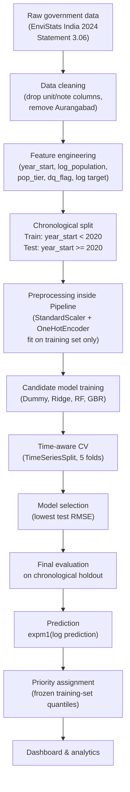

# WasteWise AI — Technical Methodology

## System Type

WasteWise AI is a **supervised regression** system.

It estimates a continuous numerical target — municipal solid waste generation
in tonnes per day — from a small historical panel dataset. It is **not** a
full time-series forecasting model; it does not model serial autocorrelation
or use lagged waste values as inputs.

---

## Pipeline Overview



---

## Step-by-Step Description

### 1. Data Loading

The raw CSV at `data/raw/india_msw_city_year.csv` is read with `pandas.read_csv`.
The raw file is never modified.

### 2. Data Cleaning

| Action | Reason |
|---|---|
| Drop `unit` column | Single constant value — zero information |
| Drop `note` column | Entirely null |
| Remove Aurangabad (9 rows) | No observed waste values in any year — cannot train or evaluate |

The cleaned data is saved to `data/processed/india_msw_cleaned.csv` (405 rows × 13 columns).

### 3. Feature Engineering

All features are derived from columns already present in the raw dataset.
No external data sources are joined.

| Feature | Derivation | Rationale |
|---|---|---|
| `year_start` | Integer part of fiscal year | Encodes actual elapsed calendar time |
| `year_rank` | Ordinal 0–8 over 9 fiscal years | Discrete time index (not used as model feature) |
| `years_since_base` | `year_start − 1999` | Years since earliest observation |
| `log_population` | `log(estimated_population_in_2011)` | City size on a scale consistent with Zipf's law |
| `pop_tier` | 1 / 2 / 3 based on population thresholds | Coarse city-size categorical |
| `log_waste_generated` | `log1p(waste_generated)` | Reduces right skew (skewness 2.81 → 0.76) |
| `waste_per_capita` | `waste × 1000 / population` | Analytics only — not a model input |
| `city_mean_waste_all` | Per-city mean across all years | Analytics only — not a model input (leakage risk) |
| `dq_flag_low_early` | 1 for Delhi/Bengaluru in 1999-00 | Data-quality marker for sensitivity analysis |

**Target:** `log_waste_generated` (log1p of tonnes/day)
**Back-transform:** `numpy.expm1(prediction)` → original tonnes/day

### 4. Leakage Prevention

The following variables are **excluded from all model inputs**:

| Variable | Reason for exclusion |
|---|---|
| `waste_generated` | The raw target — would trivially reveal the answer |
| `log_waste_generated` | The transformed target |
| `waste_per_capita` | Computed directly from the target |
| `city_mean_waste_all` | Cross-year average of the target — introduces cross-temporal leakage |
| `dq_flag_low_early` | Used only in sensitivity analysis |
| `year_rank`, `years_since_base` | Redundant with `year_start`; only `year_start` is used |

All preprocessing (StandardScaler, OneHotEncoder) is wrapped in a
`sklearn.pipeline.Pipeline` and fitted exclusively on the training set.

### 5. Chronological Train / Test Split

Because observations span 1999–2023, a random split would allow future
fiscal-year information to leak into training.  A **chronological holdout**
is used instead:

| Set | Condition | Fiscal years | Observed rows |
|---|---|---|---|
| Training | `year_start < 2020` | 1999-00 → 2019-20 | **172** |
| Test | `year_start >= 2020` | 2020-21 → 2022-23 | **135** |

Rows with null `waste_generated` are excluded from both sets.
The 98 null-target rows are retained in the dataset for potential inference use.

Three cities (Gaziabad, Jodhpur, Kota) appear only in the test set;
they had no observed data before 2020-21.

### 6. Preprocessing Pipeline

A `sklearn.pipeline.Pipeline` is constructed for each candidate model:

```
ColumnTransformer
├── StandardScaler      → [year_start, log_population, pop_tier]
└── OneHotEncoder       → [city]  (handle_unknown="ignore")
        ↓
Regressor
```

The `ColumnTransformer` is always fitted on the training split only.
`handle_unknown="ignore"` ensures that cities unseen during training (including
completely new cities at inference time) receive a zero OHE vector rather than
raising an error.

### 7. Candidate Models

| Model | Key settings |
|---|---|
| `DummyRegressor` | `strategy="mean"` — predicts the training mean for every input; used as a lower-bound baseline |
| `Ridge` | `alpha=1.0` |
| `RandomForestRegressor` | `n_estimators=200`, `min_samples_leaf=2`, `random_state=42` |
| `GradientBoostingRegressor` | `n_estimators=300`, `learning_rate=0.05`, `max_depth=4`, `subsample=0.8`, `min_samples_leaf=2`, `random_state=42` |

All models are trained on `log_waste_generated` (log-space target).

### 8. Time-Aware Cross-Validation

Within the training set, `sklearn.model_selection.TimeSeriesSplit(n_splits=5)` is
used with expanding windows.  The training set is sorted by `year_start` before
splitting so that earlier fiscal years always appear in earlier folds.

Log-space RMSE from CV (mean ± std over 5 folds):

| Model | CV log-RMSE (mean) | std |
|---|---|---|
| Dummy | 1.040 | 0.111 |
| Ridge | 0.476 | 0.134 |
| Random Forest | 0.504 | 0.114 |
| **Gradient Boosting** | **0.463** | **0.111** |

### 9. Model Selection

The best model is selected by **lowest test RMSE in original units (tonnes/day)**
on the chronological holdout. Gradient Boosting was selected:

- Lowest test RMSE (581.7 t/day)
- Highest test R² (0.920)
- Best time-aware CV log-RMSE (0.463)

### 10. Final Evaluation Metrics

All metrics computed on the 135-row chronological test set, back-transformed
to original units with `numpy.expm1`.

| Model | MAE (t/day) | RMSE (t/day) | R² | MAPE (%) |
|---|---|---|---|---|
| Dummy (mean) | 1,019.8 | 2,203.8 | −0.143 | 46.7 |
| Ridge | 579.1 | 1,062.5 | 0.734 | 37.7 |
| Random Forest | 378.1 | 637.5 | 0.904 | 28.8 |
| **Gradient Boosting** | **405.9** | **581.7** | **0.920** | 34.8 |

**R² = 0.920** means the model explains approximately 92 % of the variance in
waste generation in the test set.  This is **not** the same as "92 % accuracy".

Performance varies by city size tier:

| Tier | Cities | Test rows | MAE | RMSE | R² |
|---|---|---|---|---|---|
| Tier 1 — Mega (>4 M) | 8 | 24 | 1,034 | 1,166 | 0.824 |
| Tier 2 — Large (2–4 M) | 5 | 15 | 498 | 552 | −0.760 |
| Tier 3 — Medium (<2 M) | 32 | 96 | 234 | 297 | −0.466 |

Tier 2 and Tier 3 R² values are negative on the test set, meaning the model
performs no better than the training mean for smaller cities.  This reflects
the limited number of training observations per city (~4–6 rows each).

### 11. Sensitivity Analysis

Removing the two data-quality-flagged training observations (Delhi 400 t/day
and Bengaluru 200 t/day in 1999-00) increases test RMSE by +61.4 t/day
(581.7 → 643.2 t/day).  These rows are retained in the processed dataset
with `dq_flag_low_early = 1`.

### 12. Prediction

At inference time, `src/prediction.py::predict_waste(city, population_2011, year)`:

1. Validates inputs (population > 0, year plausibility).
2. Constructs a single-row `pd.DataFrame` with `year_start`, `log_population`,
   `pop_tier`, and `city`.
3. Passes it through the fitted sklearn Pipeline.
4. Returns `numpy.expm1(log_prediction)` as `prediction_tpd`.
5. Issues warnings for unseen cities, extrapolation years, and sub-500 k populations.

### 13. Priority Derivation

Priority is **not** a separately trained classifier.  It is a rule applied
after the regression prediction:

```
LOW    :  predicted_waste <= 510.43 t/day
MEDIUM :  510.43 < predicted_waste <= 1010.0 t/day
HIGH   :  predicted_waste > 1010.0 t/day
```

The thresholds are the 33rd and 67th percentiles of the **training-period**
observed waste distribution (n = 172 rows, `year_start < 2020`).

The test set is deliberately excluded from threshold construction to prevent
information leakage.

### 14. Explainability

`src/prediction.py::explain_prediction(result)` produces a plain-language
summary per prediction describing:

1. Population scale (log_population, ~69 % of model importance)
2. Year / time trend (year_start, ~16 % of model importance)
3. City-specific adjustment (OHE city dummy, ~15 % combined)

Every explanation includes the disclaimer:

> "Feature importance scores reflect the model's reliance on each input for
> splitting decisions. They are correlational, not causal."

### 15. Dashboard Integration

The Streamlit application (`app.py` + `pages/`) consumes:

- `src/prediction.py` — prediction and explanation
- `src/priority.py` — priority classification and threshold metadata
- `src/analytics.py` — historical data queries returning DataFrames
- `src/ui_utils.py` — shared CSS, theme toggle, sidebar branding, warning helpers

The model artifact (`models/best_model.joblib`) is loaded once per session
and cached.  Data files are loaded with `@st.cache_data` decorators.

---

## What This System Is Not

- It is **not** a time-series forecasting model (no lag features, no ARIMA, no LSTM).
- It is **not** trained on real-time or live sensor data.
- It does **not** incorporate weather, traffic, satellite imagery, GPS, or
  any external API data.
- It is **not** a policy-recommendation engine; it estimates waste volumes
  and assigns relative priority bands.
- Priority labels are relative to the modeling dataset and should not be
  treated as absolute operational thresholds.
